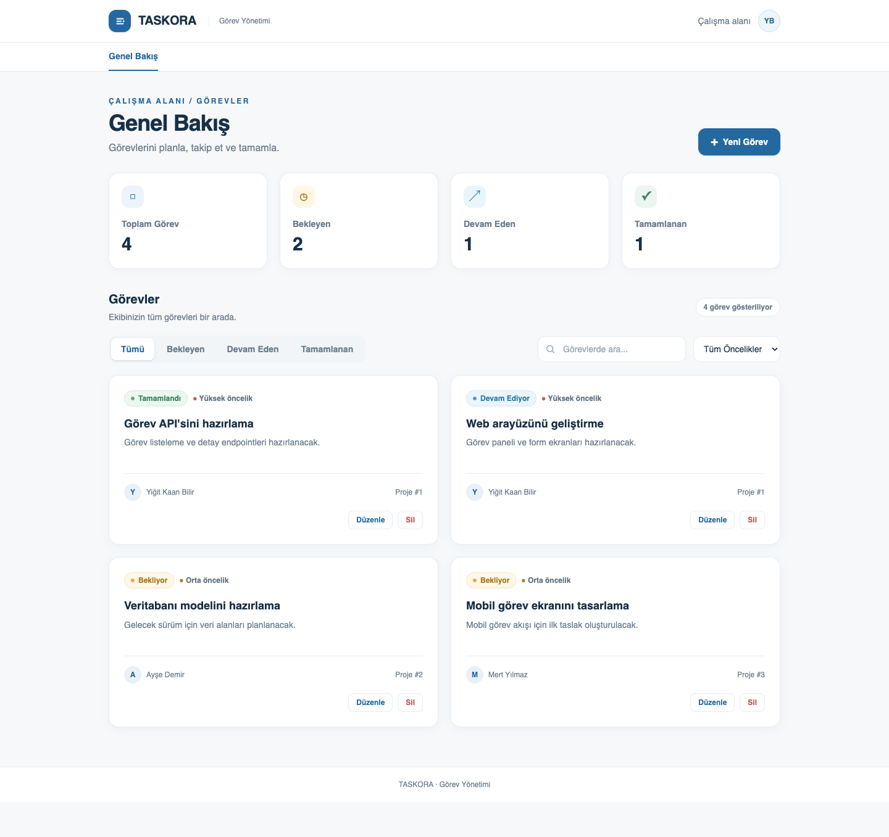
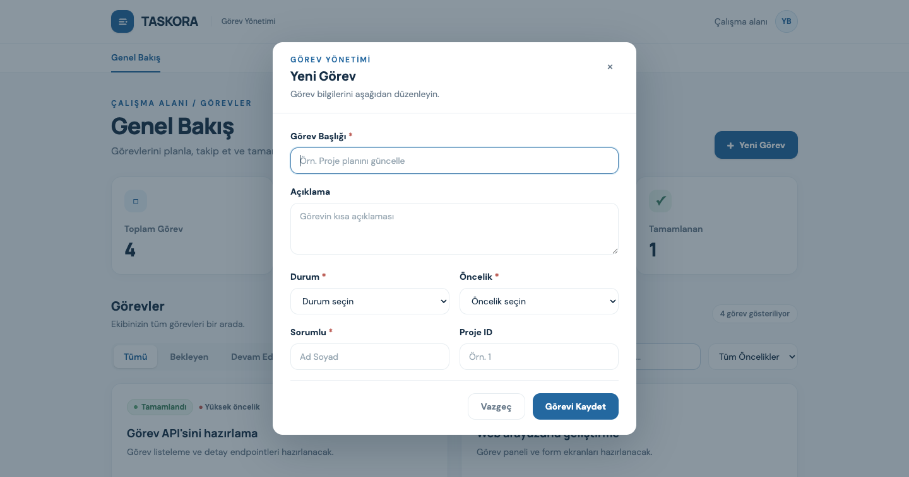
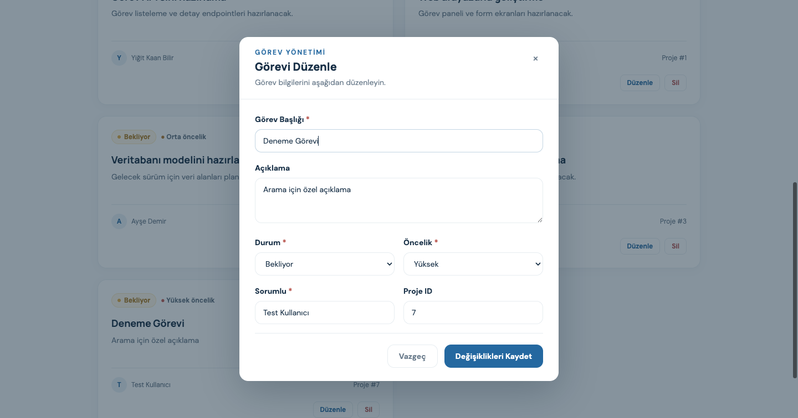
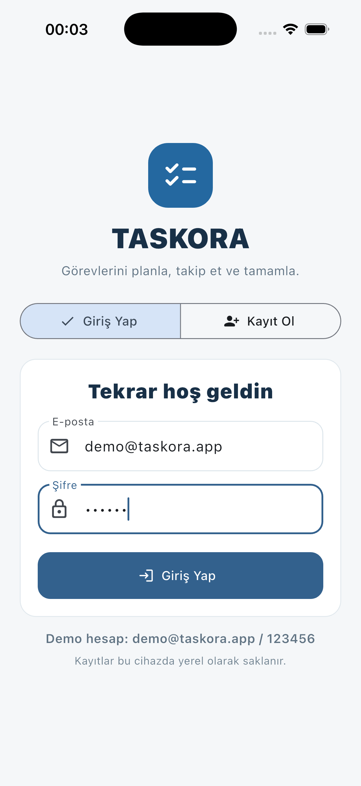
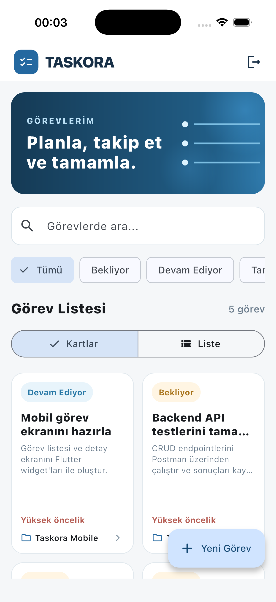
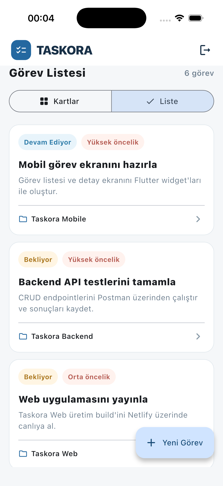
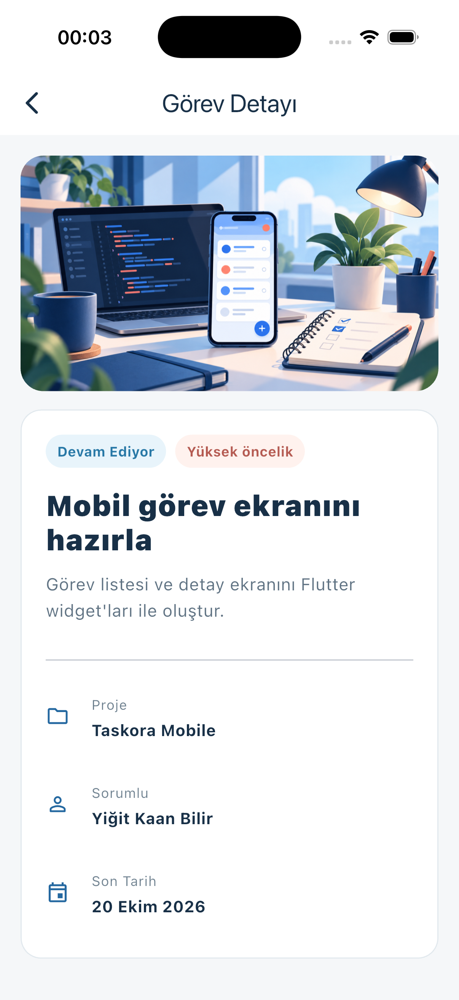
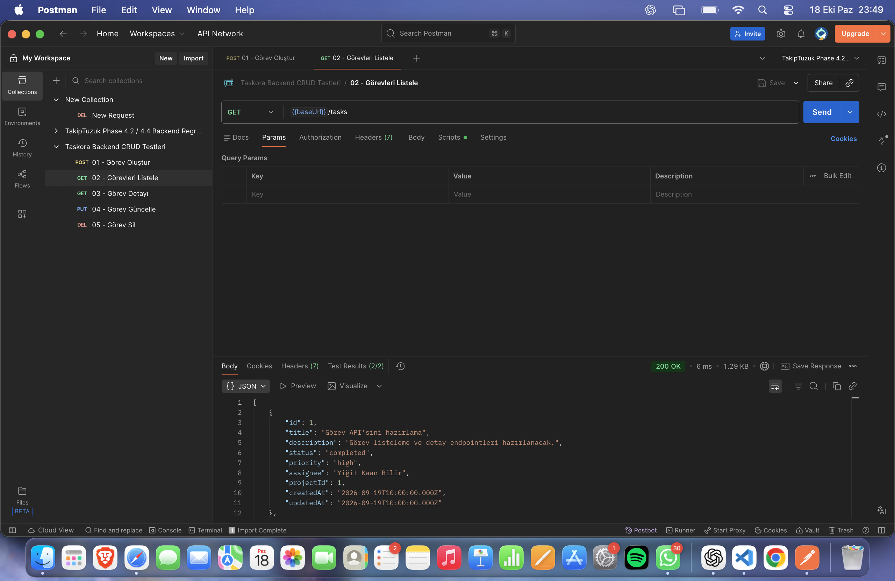
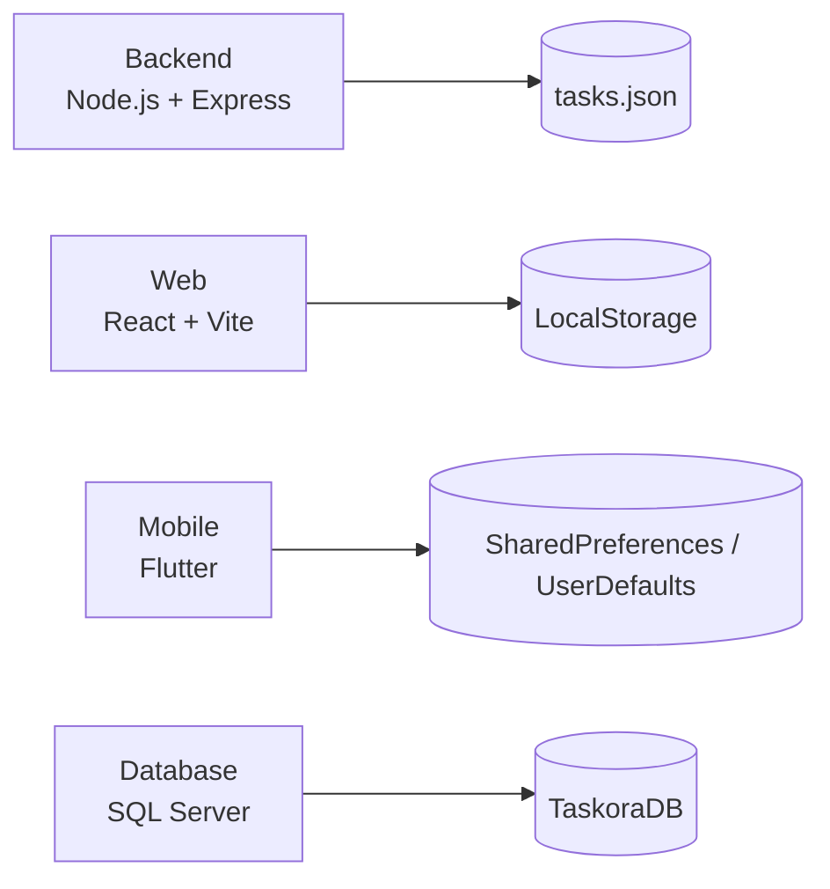

# Taskora

Taskora, görev ve ekip yönetimi senaryosunu Backend, Web, SQL ve Mobile geliştirme alanlarında ele alan çok modüllü bir eğitim projesidir.

Proje, **Software Persona Yazılım / Kariyer Merkezi 18. Dönem** programı kapsamında her alanın teknik kazanımlarını aynı ürün fikri üzerinde göstermek amacıyla geliştirilmiştir.

**Geliştirici:** Yiğit Kaan Bilir

**Canlı web uygulaması:** <https://idyllic-belekoy-ce4466.netlify.app>

**GitHub:** <https://github.com/yiqitkaan/Taskora>

## Projenin Amacı

Taskora; görev oluşturma, güncelleme, filtreleme, durum takibi ve ekip çalışması gibi temel işlevleri farklı platformlarda uygulayan bir görev yönetimi sistemidir. Depodaki dört modül ortak alan modelini kullanır ve kendi eğitim kapsamına uygun biçimde bağımsız çalışır.

Bu yapı sayesinde aynı ürün senaryosu üzerinde REST API geliştirme, React arayüz tasarımı, ilişkisel veri modelleme ve Flutter mobil geliştirme çalışmaları birlikte görülebilir.

## Modüller

| Modül | Teknolojiler | Veri kaynağı | Kapsam |
| --- | --- | --- | --- |
| [Backend](taskora-backend/) | Node.js, Express.js, JavaScript | JSON dosyası | REST API, CRUD, doğrulama, middleware ve hata yönetimi |
| [Web](taskora-web/) | React, Vite, Tailwind CSS | LocalStorage | Görev paneli, arama, filtreleme, istatistik ve CRUD |
| [Database](taskora-database/) | Microsoft SQL Server, T-SQL | TaskoraDB | İlişkisel şema, analiz sorguları, VIEW ve BACKUP |
| [Mobile](taskora-mobile/) | Flutter, Dart, Material Design | Cihazda kalıcı yerel JSON | Giriş, kayıt, görev yönetimi ve çevrim dışı kullanım |

## Uygulama Görselleri

### Web

<p align="center">
  
</p>

<p align="center">
  
  
</p>

### Mobile

<p align="center">
  
  
  
  
</p>

### Backend API

<p align="center">
  
</p>

## Mimari



Backend, Web ve Mobile mevcut sürümde kendi yerel veri kaynaklarıyla çalışır. TaskoraDB, ürünün ilişkisel veri modeli ve SQL raporlama katmanını gösterir. Modüllerin tek API ve merkezi veritabanı üzerinden birleştirilmesi sonraki geliştirme adımıdır.

## Öne Çıkan Özellikler

### Backend

- REST yaklaşımıyla görev oluşturma, listeleme, detay görüntüleme, güncelleme ve silme
- Controller, router ve middleware katmanlarının ayrılması
- Durum ve öncelik filtreleri
- Zorunlu alan, enum, ID ve bozuk JSON doğrulamaları
- Açıklayıcı `400`, `404` ve `500` yanıtları
- Paylaşılabilir Postman koleksiyonu ve test görselleri

### Web

- Görev ekleme, düzenleme, silme ve listeleme
- Başlık ve açıklamada arama
- Durum ve öncelik filtreleri
- Görev durumlarına göre canlı istatistik kartları
- LocalStorage ile tarayıcıda kalıcılık
- Responsive arayüz ve Netlify dağıtımı

### Database

- Users, Projects, Tasks, TaskComments ve ProjectMembers tabloları
- Primary Key, Foreign Key, UNIQUE, CHECK ve DEFAULT kısıtları
- JOIN, LEFT JOIN, GROUP BY, COUNT, subquery ve DATEDIFF analizleri
- `dbo.vw_TaskoraGorevOzet` görünümü
- `BACKUP DATABASE` ve gerçek SQL Server doğrulaması

### Mobile

- Yerel demo giriş, kullanıcı kaydı ve çıkış
- Görev ekleme, düzenleme, arama, filtreleme ve durum güncelleme
- Görev kartları, detay ekranı ve yerel görsel varlıklar
- Model sınıflarında `fromJson` ve `toJson`
- Android SharedPreferences ve iOS UserDefaults üzerinde JSON kalıcılığı
- Android ve iOS desteği

## Hızlı Başlangıç

### Backend

Gereksinim: Node.js 18 veya üzeri.

```bash
cd taskora-backend
npm ci
npm start
```

API varsayılan olarak <http://localhost:3000> adresinde çalışır.

| Method | Endpoint | İşlem |
| --- | --- | --- |
| `POST` | `/tasks` | Yeni görev oluşturur |
| `GET` | `/tasks` | Görevleri listeler |
| `GET` | `/tasks/:id` | Görev detayını getirir |
| `PUT` | `/tasks/:id` | Görevi günceller |
| `DELETE` | `/tasks/:id` | Görevi siler |

### Web

```bash
cd taskora-web
npm ci
npm run dev
```

Production kontrolü:

```bash
npm run build
npm run preview
```

### Mobile

Gereksinim: Flutter SDK ve çalışır durumda bir Android Emulator veya iOS Simulator.

```bash
cd taskora-mobile
flutter pub get
flutter run
```

Kalite kontrolleri:

```bash
flutter analyze
flutter test
```

### Database

[SQL dosyasını](taskora-database/YigitKaanBilir_Taskora_Proje.sql) SQL Server Management Studio ile açıp yeni bir SQL Server örneğinde çalıştırın. Backup adımı için SQL Server makinesinde `C:\Yedek` klasörünün ve servis hesabı yazma izninin bulunması gerekir.

## Doğrulama

| Alan | Yapılan kontrol |
| --- | --- |
| Backend | Postman üzerinden CRUD ve hata senaryoları |
| Web | Vite production build ve Netlify yayını |
| Database | SQL Server 2022 üzerinde temiz kurulum, sorgular, VIEW ve `RESTORE VERIFYONLY` |
| Mobile | `flutter analyze`, widget testleri, Android debug ve iOS Simulator build |

## Depo Yapısı

```text
Taskora/
├── taskora-backend/     # Express REST API
├── taskora-web/         # React web uygulaması
├── taskora-database/    # SQL Server veri modeli
└── taskora-mobile/      # Flutter mobil uygulaması
```

## Teknik Dokümantasyon

- [Backend kurulum ve API dokümanı](taskora-backend/README.md)
- [Backend Postman test rehberi](taskora-backend/POSTMAN_TESTLERI.md)
- [Web kurulum dokümanı](taskora-web/README.md)
- [Database kurulum dokümanı](taskora-database/README.md)
- [Mobile kurulum dokümanı](taskora-mobile/README.md)

## Geliştirme Yol Haritası

- Web ve Mobile istemcilerini ortak Backend API’ye bağlamak
- JSON ve LocalStorage veri kaynaklarını TaskoraDB ile birleştirmek
- Sunucu tabanlı kimlik doğrulama ve yetkilendirme eklemek
- Otomatik test ve CI iş akışları oluşturmak
